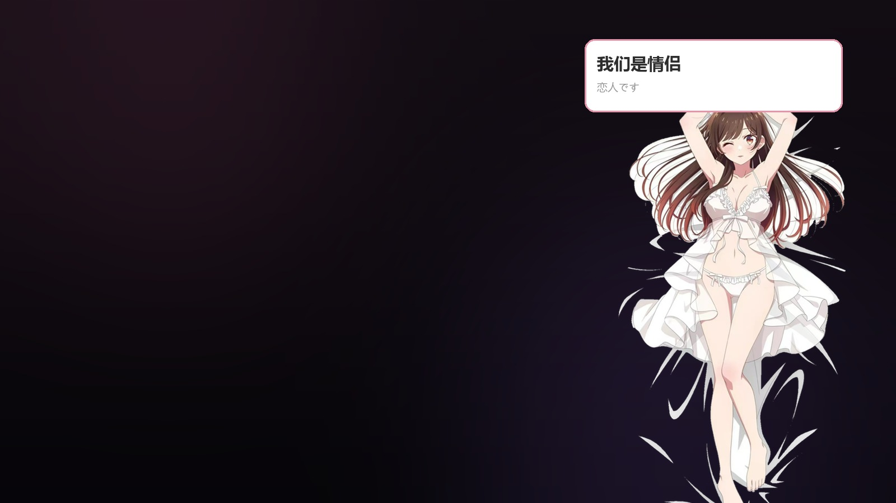
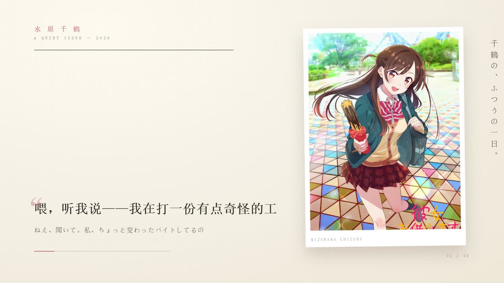
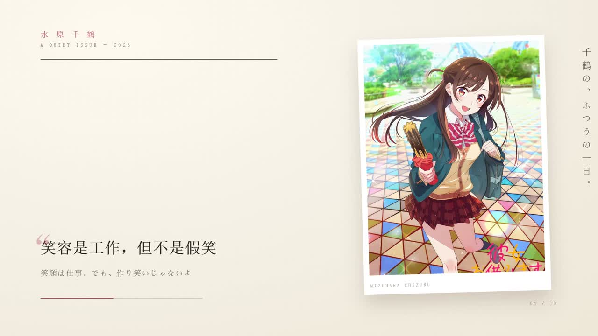
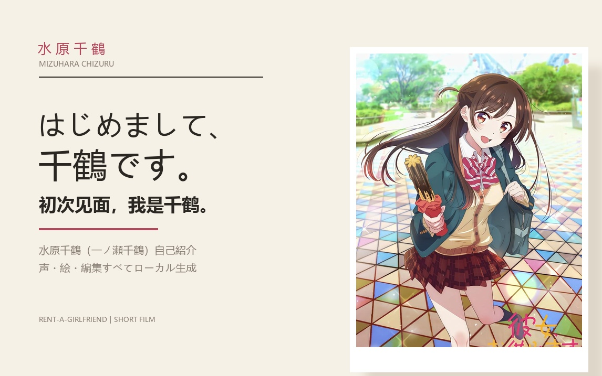

# 水原千鶴 · 二次元桌宠 + 自主生活循环

一个完全跑在**自己电脑上**的「水原千鶴」（《出租女友》）角色项目：性格、声音、B 站活动、做视频，
以及一个会自己决定「现在想做什么」的生活循环。

[](LICENSE)




## 演示

https://www.bilibili.com/video/BV1GJx167Ep9 （自己投稿的自我介绍短片）

仓库内也带了一个压缩版：[`docs/demo.mp4`](docs/demo.mp4)（720p，7.6 MB，40 秒）

做视频不是套模板，而是**用网页动画渲染**的：

| 片头 | 杂志内页 | 结尾 |
|---|---|---|
|  |  |  |

封面也是脚本生成的（`tools/make_cover.py`）：



## 它能做什么

| 模块 | 能力 |
|---|---|
| **性格** | 四种语气（素 / 営業 / 衝突 / 软肋），人格卡 `card_v0_4.md` |
| **声音** | GPT-SoVITS 音色克隆（日语），气泡显示中日双语字幕 |
| **桌宠** | PySide6 透明窗口，60fps 呼吸动画、置顶、拖动、`Ctrl+Alt+Z` 唤输入 |
| **工具** | 联网搜索、抓网页、读写文件、跑 PowerShell / Python、子代理 |
| **B 站** | 自己搜索 / 挑视频 / 发评论 / 点赞 / 收藏 |
| **记忆** | 本地持久化 + 自动压缩摘要（重启不失忆） |
| **自主生活** | 定时醒来 → 自己决定做什么 → 在气泡里显示（逛 B 站 / 写日记 / 练台词 / 主动找你） |
| **做视频** | 网页动画逐帧渲染 + ffmpeg 合成，可出 1080p 60fps |

## 它和"只会回话"的桌宠差在哪

- **主动权**：不是等你按按钮，而是每 22~45 分钟自己醒一次，读状态和记忆，自己决定做什么
- **状态**：精力、心情、上次做了什么都会影响她这次的选择
- **会主动联系**：符合条件时会自己发消息（限频，不会刷屏）
- **会动手**：不是只会聊天——能真的去 B 站逛、发评论、写代码、改文件

## 目录结构

```
pet/            桌宠本体
  pet.py          窗口 / 动画 / 输入 / 生活循环调度
  brain.py        人格、对话、记忆压缩、带工具的 agent 循环
  voice.py        GPT-SoVITS worker 封装
  actions.py      工具集（B站 / 文件 / 命令 / 联网 / 子代理）
  life_core.py    自主生活：状态、决策、行动
tools/          B站自动化、做视频、生图、训练、抓素材
docs/           安装文档 + 演示素材
card_v0_4.md    人格卡
启动桌宠.bat     一键启动
```

## 快速开始

```bash
pip install PySide6 requests soundfile lameenc numpy pillow
copy pet\config.example.json pet\config.json   # 填自己的 DeepSeek API Key
pythonw pet\pet.py
```

完整安装（声音 / 生图 / B站 / 做视频）：见 **[docs/INSTALL.md](docs/INSTALL.md)**

## 踩过的坑（写在文档里了）

- 参考音频**不要降噪、不要人声分离**——音色会被毁掉，听起来就"糊"
- ComfyUI 新版需要 **torch ≥ 2.7**，否则 `comfy_kitchen` 直接崩
- Chrome 136+ 禁止对默认配置开调试端口，B 站自动化必须用**独立配置目录**
- 网页动画渲染要按**时间轴**驱动，不能靠 CSS 动画——否则截帧和音频会错位
- 角色 LoRA 想学得像，数据必须**同画风、脸占比大**，混画风只会训出"泛二次元脸"

## 说明

- 仓库**不含**语料视频、模型权重、训练集、聊天记忆与登录态（已在 `.gitignore`）
- 角色与素材版权归原作者及版权方所有，本项目仅作个人本地学习实验，不用于分发
- 授权：[MIT](LICENSE)
